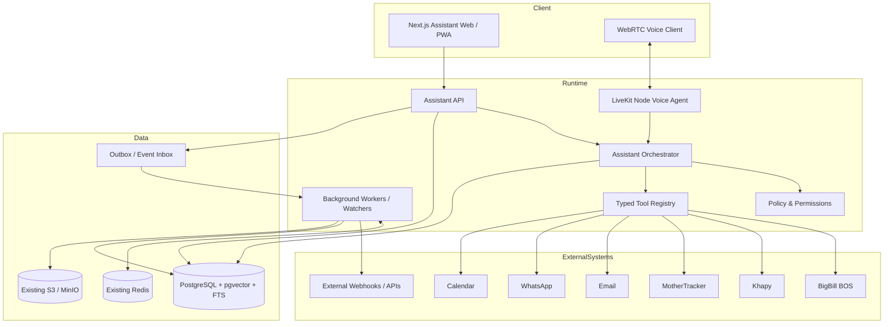
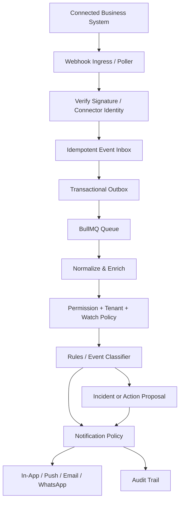
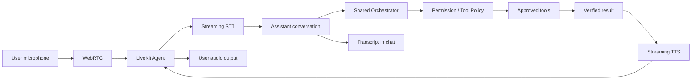
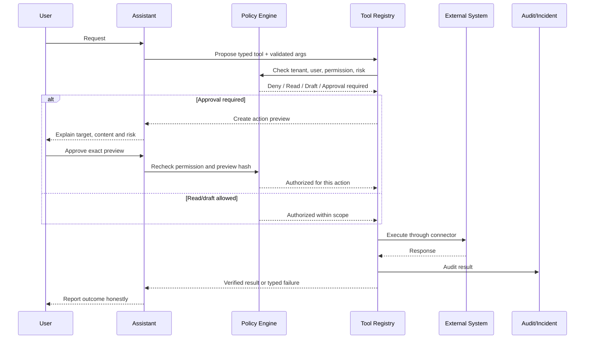

# BigBill AI Assistant — Architecture Decision Record
## Selected Stack, RAG, Event Watchers, Voice and Backend Contracts

**Status:** Recommended baseline for implementation approval  
**Applies to:** BigBill AI Assistant platform, Loop 1 foundation and the next integration loops  
**Companion documents:**
- `BigBill_AI_Assistant_Loop1.md`
- `BigBill_AI_Assistant_Technical_Workbook_Loop1.md`

**Decision summary:** Use a TypeScript-first modular platform; PostgreSQL + pgvector + PostgreSQL full-text search for initial hybrid RAG; Redis + BullMQ for background jobs and watcher workers; a versioned contract layer for all backend modules; an explicit policy-controlled action engine; and LiveKit Agents for Node.js with WebRTC for voice.

This is a concrete target architecture, not permission to disregard an existing repository. During discovery, agents must verify the repository's actual stack and existing BigBill infrastructure. Preserve working conventions and reuse services where they already meet the contract. Any deviation from this decision requires an Architecture Decision Record (ADR) with evidence, cost/operational impact, alternatives and approval.

---

# 1. Technology decisions at a glance

| Concern | Selected baseline | Why |
|---|---|---|
| Language | TypeScript end-to-end | Shared types, fast iteration, one main engineering language |
| Runtime | Node.js; align to the established repository runtime (known BigBill/Khapy baseline has used Node 22.23.2) | Reuse existing runtime knowledge and deployment patterns |
| Web interface | Next.js App Router + React + TypeScript | Fits the wider BigBill/Khapy ecosystem and supports standalone responsive chat |
| Backend API | Node.js API using the repository's established Express conventions; for a genuinely new API with no existing framework, Fastify is the preferred alternative, not an additional parallel framework | Avoid framework sprawl; preserve working code |
| API contracts | Zod runtime schemas + OpenAPI 3.1; shared TypeScript contract package | One schema source for validation, typed calls and external integrations |
| Database | Existing PostgreSQL deployment | Structured data, durable state, transactions and multi-tenant data |
| ORM | Drizzle where the assistant is greenfield and no ORM convention already exists; otherwise keep the repository ORM | Existing team familiarity and typed schema/migrations |
| RAG vector search | pgvector extension in PostgreSQL | Avoid a separate vector database at the initial scale |
| RAG lexical search | PostgreSQL full-text search (GIN/tsvector) | Hybrid retrieval over one data platform |
| RAG ranking | Dense + lexical retrieval, Reciprocal Rank Fusion (RRF); add a reranker only after measured evaluation | Good relevance without adding a required external service initially |
| Document extraction | Existing Apache Tika capability if available; otherwise a small extraction adapter selected after file-type tests | Reuse known document-processing capability |
| Background jobs | BullMQ workers over the existing Redis service | Retries, delayed/scheduled jobs, concurrency, rate limits and job events |
| Event reliability | PostgreSQL transactional outbox + idempotent event inbox + BullMQ | Avoid losing events between DB commits and queue publishing |
| Agent orchestration | Small typed TypeScript orchestrator + persisted workflow/action state machines | Clear control, lower framework overhead and predictable approvals |
| Tool execution | Typed tool registry + server-side policy engine | No free-form model execution |
| Voice | LiveKit Agents for Node.js + WebRTC | Realtime audio transport, turn handling, interruption support and pluggable speech/model providers |
| Initial voice providers | Deepgram STT + existing approved LLM provider gateway + ElevenLabs TTS where credentials/licensing/cost are approved; alternatives remain adapter-based | Reuse known provider experience while keeping components replaceable |
| Live voice alternative | OpenAI Realtime/GPT-Live adapter can be evaluated as a provider option, not a separate business logic path | Lower-latency speech-to-speech option if cost and provider terms justify it |
| Live updates | Server-Sent Events for chat/action/incident updates where sufficient; WebSocket only where bidirectional realtime needs justify it; WebRTC for voice media | Keep text and audio transport appropriately simple |
| Observability | Existing structured logger + OpenTelemetry traces and metrics | Correlate user requests, RAG retrieval, jobs, tools, voice and failures |
| Deployment | Existing Docker + Coolify + Traefik/VPS conventions after resource verification | No unnecessary infrastructure migration |
| CI | Existing GitHub Actions | Preserve stable workflow; no paid CI or unrelated workflow changes |

## 1.1 Important framework choice

Do **not** introduce LangChain, LangGraph, Mastra, an agent framework and a home-grown orchestration framework all together.

For this product's first iterations, implement a compact in-house orchestrator that:
- receives a validated user request;
- creates a plan with typed steps;
- calls only tools in the registry;
- checks permission and risk policy;
- persists action/workflow state;
- asks for approval when needed;
- resumes from stored state;
- verifies the result;
- reports completion or incident.

Use explicit state machines and BullMQ for asynchronous work. Evaluate a graph/workflow framework only if a demonstrated workflow complexity exceeds what this small orchestrator can safely handle. The assistant must not become coupled to one model vendor or one agent framework.

## 1.2 No new infrastructure by default

Use existing PostgreSQL, Redis, object storage, email and model-provider configuration where verified. Do not add hosted vector DB, managed workflow service, paid observability platform, separate Kafka cluster, paid CI, or another AI provider without a cost/benefit review and explicit approval.

---

# 2. Target deployment shape

Start as a **modular monorepo with independently runnable processes**, not a fleet of tiny microservices.



### Suggested workspace boundaries (adapt after repository discovery)

Illustrative only:

```text
apps/
  assistant-web/       # Next.js chat, approvals, permissions, incidents
  assistant-api/       # HTTP API, auth integration, orchestrator entry point
  assistant-worker/    # RAG ingestion, watchers, scheduled sync, notifications
  assistant-voice/     # LiveKit Node.js agent server

packages/
  contracts/           # Zod schemas, OpenAPI, event schemas, shared DTOs
  domain/              # domain types, action state machines, policies
  assistant-core/      # orchestration, planning, context assembly
  tool-registry/       # typed tool definitions and dispatcher
  permissions/         # authorization, consent and risk checks
  rag/                 # parsing pipeline, chunking, retrieval, citations
  connectors/          # adapters for BOS, Khapy, MotherTracker, mail, WhatsApp
  events/              # event envelope, inbox/outbox, idempotency
  notifications/       # in-app, email, push or WhatsApp notification adapters
  observability/       # trace/metric context and safe structured logging
```

Do not force this exact folder layout if existing repositories use another pattern. Preserve the module ownership and contracts even if the physical layout differs.

---

# 3. RAG architecture — fast, useful, tenant-safe

## 3.1 Selected initial RAG stack

- PostgreSQL as the canonical metadata and content-index database.
- pgvector for dense vector similarity.
- PostgreSQL full-text search for lexical retrieval.
- One embedding adapter that can call an approved existing embedding provider.
- Document extraction through the existing Apache Tika capability where verified.
- BullMQ workers for ingestion, reindexing, connector sync and cleanup.
- Object storage (existing S3/MinIO) for original files and large extracted artefacts.
- RRF to combine dense and lexical search.
- Optional reranking stage only after an evaluation set proves it improves relevance enough to justify latency/cost.

pgvector supports exact nearest-neighbour search and HNSW/IVFFlat approximate indexes. Its documentation also describes combining vector retrieval with PostgreSQL full-text search for hybrid search and using RRF or a cross-encoder to combine results. HNSW generally offers a stronger speed/recall tradeoff at the cost of greater memory and slower index construction than IVFFlat. Do not select index parameters by guesswork; benchmark the actual corpus and VPS memory. References: https://github.com/pgvector/pgvector

## 3.2 Why not a separate vector database at the beginning?

Initial corpus likely consists of:
- the organization's approved documents;
- policies, procedures and company profile;
- product specifications;
- customer/account context available by permission;
- conversations and task summaries approved for memory;
- marketing/product knowledge;
- selected operational records exposed through APIs.

Keeping metadata, ACLs, source links and embeddings in PostgreSQL reduces system count and makes transactions and tenant scoping easier. Revisit a dedicated vector service only when load tests, corpus scale, isolation needs or query latency demonstrate a real requirement.

## 3.3 RAG ingestion pipeline


### Ingestion requirements

Each source/document must retain:
- `tenant_id`;
- `workspace_id` if the existing architecture uses workspaces;
- `source_system`;
- `source_record_id`;
- `document_id` and immutable version identifier;
- title and canonical source URL/path;
- MIME type;
- page/section/heading where available;
- owner/visibility/ACL reference;
- ingestion timestamp;
- source modification timestamp;
- content hash;
- parser/version;
- embedding provider/model/dimensions;
- deletion/tombstone state;
- retention policy.

Never index a source unless its owner has granted the relevant connector/document scope. When a source permission is revoked or a document is deleted, remove or invalidate derived chunks and embeddings according to the retention policy.

### Chunking strategy

- Prefer structure-aware chunks based on headings, paragraphs, tables and pages.
- Keep headings with their associated content.
- Avoid splitting a table from its header.
- Preserve source page numbers and section names for citations.
- Use overlap sparingly and measure the effect; do not blindly use fixed huge overlap.
- Store chunk order and adjacent-chunk IDs so the system can expand a retrieved passage when needed.
- Keep original document bytes in object storage; store extracted text and metadata according to retention policy.
- Handle scanned PDFs as an explicit OCR capability; do not assume text extraction succeeded.
- Record parse failures as ingestion incidents and never silently index an empty document.

## 3.4 Hybrid retrieval

Initial retrieval sequence:

1. Authenticate request and resolve tenant/workspace and user.
2. Determine the user's access scope for each connected source.
3. Rewrite/expand the query only where it materially helps; preserve the original query.
4. Run lexical PostgreSQL full-text search.
5. Run vector nearest-neighbour retrieval through pgvector.
6. Apply tenant and ACL constraints in the retrieval query—not as a UI-only filter.
7. Combine ranked lists with RRF.
8. Optionally rerank a small candidate set with a cross-encoder/model when configured.
9. Select a bounded context window.
10. Return source citations and freshness metadata with the answer.
11. Record retrieval trace metadata without logging sensitive content unnecessarily.

Do not make an LLM decide whether the user is allowed to read a retrieved document. Authorization is code-enforced before the document is placed in model context.

### pgvector multi-tenancy warning

The pgvector documentation warns that approximate-index filtering can affect recall when different tenants share an approximate index: filters may be applied after the index scan, reducing the number of matching rows returned. The implementation must benchmark filtered retrieval and choose an appropriate design.

Initial safe approach:
- mandatory tenant filter at query boundary;
- PostgreSQL Row-Level Security as defence in depth where compatible with repository auth/data access;
- per-request DB transaction with tenant context set safely;
- metadata indexes for tenant/source/ACL fields;
- enable and tune iterative HNSW scans if needed;
- add cross-tenant negative tests.

As scale increases, evaluate partitioning, tenant-group partitions or isolated indexes for large tenants. Do not assume one shared HNSW index will provide perfect isolation and consistent recall for every tenant. Reference: https://github.com/pgvector/pgvector

## 3.5 RAG evaluation before “good enough”

Create a small representative evaluation set before launching RAG:
- 30–50 realistic user questions across organization, product, operations and policy documents;
- expected source document/page;
- expected key answer facts;
- examples the assistant must refuse due to permission or missing source.

Track:
- Recall@k / whether the authoritative source appears;
- citation correctness;
- answer faithfulness to retrieved text;
- permission leakage (must be zero);
- stale-source rate;
- ingestion freshness;
- query latency;
- embedding and reranking cost.

An answer with no adequate evidence must say it could not find a reliable source rather than invent one.

---

# 4. The “always watching” architecture

“Always watching” means **permissioned event monitoring of connected business systems**, not unrestricted access to every system and not continuous microphone recording.

## 4.1 Watcher types

1. **Webhook watchers:** receive events from systems that can notify changes.
2. **Scheduled sync watchers:** poll systems that do not provide reliable webhooks.
3. **Health watchers:** monitor connector authorization, API failures, queue lag, worker heartbeats and service health.
4. **Business-rule watchers:** detect conditions using authorized and verified data, such as an overdue prospect follow-up or failed integration.
5. **User commitment watchers:** remind the user about tasks and follow-ups they created or approved.

Each watcher must have:
- tenant and connector scope;
- explicit enabled/disabled state;
- permission grant reference;
- source cursor/watermark;
- frequency or webhook mode;
- last successful sync;
- next scheduled sync;
- last error;
- retry/backoff state;
- freshness SLA;
- event deduplication key;
- notification policy.

## 4.2 Event processing path



### Reliable delivery rules

BullMQ provides workers, queues, delayed/scheduled jobs, retries/backoff, priorities, rate limiting, concurrency, job events and idempotency-related patterns. Its delivery semantics are at-least-once, so processors must be idempotent; a worker can process a job more than once after a crash or lock loss. Use this intentionally, not as an assumption of exactly-once execution. Reference: https://docs.bullmq.io/

Implement:
- transactional outbox for events created within our DB transaction;
- idempotent inbox for provider webhooks;
- stable provider event IDs or generated deduplication keys;
- bounded retries with exponential backoff and jitter;
- dead-letter/failure handling;
- connector rate limits and per-tenant concurrency limits;
- queue lag and worker heartbeat monitoring;
- cursor-based sync so a restart resumes without losing changes;
- periodic reconciliation to catch missed webhook events;
- explicit cancellation and revocation behavior.

Never enqueue a consequential external action in a way that can be repeated without idempotency or approval checks.

## 4.3 Notification intelligence

Do not notify the owner about every event.

Use priority policy:
- **Critical:** security/tenant mismatch, suspected data leak, critical production outage.
- **High:** failed business-critical integration, blocked payroll/payment workflow, missed critical deadline.
- **Normal:** prospect follow-up due, customer reply, scheduled report available.
- **Digest:** routine summaries, low-priority changes.

Each notification should contain:
- what happened;
- why it matters;
- affected system/business record;
- when it happened;
- confidence/source;
- what the assistant has already done;
- what decision is needed;
- action buttons (where safe).

Add user-controlled quiet hours, notification channels, per-category preferences, deduplication and escalation windows. Critical incidents may override ordinary quiet hours only if the organization has explicitly configured that policy.

## 4.4 No silent always-on microphone

Default voice mode is push-to-talk or user-initiated voice session. The UI must show a clear active-microphone indicator and session state. Any wake-word or continuous listening mode is a separate opt-in with explicit device-level permissions, visible indication, retention rules and stop control. The assistant's business watchers must never imply that it is listening to the user's room.

---

# 5. Voice architecture

## 5.1 Selected voice stack

- **Transport:** WebRTC.
- **Voice runtime:** LiveKit Agents for Node.js.
- **Speech-to-text:** Deepgram adapter as the initial candidate, subject to account/price/latency testing.
- **LLM:** same provider-neutral assistant model gateway and policy engine used by text.
- **Text-to-speech:** ElevenLabs adapter where approved credentials and budget exist; Cartesia/other supported provider as alternative.
- **Voice session state:** stored/linked to the same assistant conversation ID.
- **Tool access:** same tool registry, tenant, permissions and approval rules. Voice must not be a more privileged execution path.

LiveKit has a Node.js Agents SDK and documents support for WebRTC clients, streaming STT/LLM/TTS integrations, semantic turn detection, interruptions and multiple providers. It is open-source and can be self-hosted, but infrastructure sizing and network requirements must be tested before deployment. References: https://docs.livekit.io/reference/agents-js/ and https://docs.livekit.io/agents/

### Why LiveKit rather than implementing voice from scratch?

It already deals with difficult realtime interaction concerns—media transport, turn detection, interruptions, audio streaming and integrations. This lets BigBill focus on its own assistant, tools, permissions and business workflows instead of building a speech platform.

### Voice interaction flow



### Voice rules

- Start with push-to-talk/session-based mode.
- Support interruption/barge-in and semantic turn detection.
- Show live connection, listening, thinking, speaking, muted and disconnected states.
- Provide live transcription and retain it according to policy.
- Let user switch voice/text without starting a new conversation.
- Use the same context and action history across modes.
- Do not speak confidential information aloud by default when the user may be in a public environment; provide a privacy mode.
- Do not speak out secrets or authentication credentials.
- Ask for confirmation before consequential action, even if the instruction arrived by voice.
- On poor network, degrade to text and preserve the conversation.
- Voice failure creates a recoverable incident; it must not lose the user's request.

### LiveKit deployment constraint

LiveKit can be self-hosted, but WebRTC needs correct network/UDP/TLS configuration and resource planning. Do not deploy a new media service to the already-used production VPS without a staging resource test. Prefer a separately controllable process/container and measure concurrent sessions, CPU, memory, bandwidth and reconnect behavior. No LiveKit Cloud or other paid hosted service without explicit approval.

### Provider selection is an adapter decision

The initial providers above are candidates, not a permanent vendor lock-in. Run a measured comparison for:
- Zambian/English accents and names;
- noisy environments;
- proper nouns and company names;
- latency to first transcript/audio;
- interruption quality;
- cost per minute;
- voice quality;
- regional/data processing terms.

Do not select based only on a demo. LiveKit supports multiple Node.js plugins, including Deepgram and ElevenLabs; verify exact package/model availability and pricing when implementation begins.

For highly natural speech-to-speech later, evaluate an OpenAI Realtime/GPT-Live adapter. Its current documentation describes WebRTC for browser audio, low-latency conversational sessions, interruptions and tool/delegation flows. Keep it behind the same voice and tool contracts so it does not replace the assistant's policy layer. References: https://developers.openai.com/api/docs/guides/realtime and https://developers.openai.com/api/docs/guides/live

---

# 6. Backend modules and contracts

All modules communicate through typed interfaces and versioned events. Modules own their logic and data; other modules use their public contracts, not internal tables.

## 6.1 Contract package

Use one shared contract package, for example `packages/contracts`.

- Runtime schemas: Zod (or the existing equivalent if already standardized).
- HTTP contract: OpenAPI 3.1.
- Event contract: versioned JSON Schema/Zod.
- DTO naming and error envelope standardized.
- Generate client types where supported.
- Breaking contract changes require version bump/migration plan.

## 6.2 Core module contracts

| Module | Interface/contract | Owns |
|---|---|---|
| Identity & Tenant | `IdentityContext`, `TenantContext`, `MembershipPort` | trusted caller/org context |
| Conversation | `ConversationPort`, `MessagePort` | threads, messages, transcript metadata |
| Model Gateway | `ModelPort`, `EmbeddingPort` | text, structured outputs, streaming, embeddings and usage |
| Orchestrator | `AssistantRuntime`, `PlanStep`, `WorkflowState` | plan and coordinate work |
| Policy | `PermissionPolicy`, `RiskDecision` | access/risk/approval decisions |
| Tool Registry | `ToolDefinition`, `ToolExecutor` | executable capabilities and schemas |
| Action | `ActionPort`, `ApprovalPort` | preview, approval, execution state |
| RAG | `IngestionPort`, `RetrieverPort`, `Citation` | document lifecycle and grounded retrieval |
| Connector | `ConnectorAdapter`, `ConnectorHealth`, `SyncCursor` | external product/provider integration |
| Watchers | `WatchSource`, `WatchConfig`, `EventEnvelope` | authorised event monitoring |
| Tasks | `TaskPort`, `ReminderPort` | assistant tasks or adapter to existing task system |
| Incidents | `IncidentPort`, `IncidentEvent` | issue lifecycle and acknowledgement |
| Notifications | `NotificationPort`, `DeliveryPreference` | in-app/push/email/WhatsApp delivery |
| Voice | `VoiceSessionPort`, `VoiceTranscriptEvent` | real-time audio session lifecycle |
| Audit | `AuditPort`, `AuditEvent` | immutable security/action record |
| Usage | `UsagePort`, `CostRecord` | model/tool usage and cost visibility |

### Example contracts (illustrative; adjust to existing repo types)

```ts
export type RiskLevel = "R0" | "R1" | "R2" | "R3" | "R4";

export interface TenantContext {
  tenantId: string;
  userId: string;
  workspaceId?: string;
  roles: string[];
  correlationId: string;
}

export interface PermissionRequirement {
  connectorId: string;
  scopes: string[];
  risk: RiskLevel;
}

export interface ToolDefinition<TInput, TOutput> {
  id: string;
  version: number;
  description: string;
  risk: RiskLevel;
  requiredScopes: string[];
  inputSchema: unknown;   // actual runtime schema must be registered
  idempotency: "required" | "naturally_idempotent" | "not_idempotent";
  execute(input: TInput, context: TenantContext): Promise<TOutput>;
}

export type ActionStatus =
  | "proposed"
  | "awaiting_approval"
  | "approved"
  | "executing"
  | "completed"
  | "failed"
  | "rejected"
  | "cancelled";

export interface ActionPreview {
  actionId: string;
  tenantId: string;
  toolId: string;
  payloadHash: string;
  summary: string;
  target: string;
  risk: RiskLevel;
  requiredScopes: string[];
  status: ActionStatus;
  expiresAt?: string;
}

export interface Citation {
  sourceId: string;
  title: string;
  uri?: string;
  page?: number;
  section?: string;
  chunkId: string;
  sourceUpdatedAt?: string;
  retrievedAt: string;
}

export interface EventEnvelope<TPayload> {
  eventId: string;
  eventType: string;
  eventVersion: number;
  tenantId: string;
  sourceSystem: string;
  sourceEventId?: string;
  occurredAt: string;
  receivedAt: string;
  correlationId: string;
  causationId?: string;
  idempotencyKey: string;
  payload: TPayload;
}
```

Do not use these illustrative `unknown` placeholders as a substitute for real validators. Every input/output must be concretely validated at runtime.

## 6.3 Event versioning

Event types follow a stable naming scheme, e.g.:
- `connector.authorization.expired.v1`
- `connector.sync.completed.v1`
- `connector.sync.failed.v1`
- `document.ingestion.requested.v1`
- `document.ingestion.completed.v1`
- `document.source.deleted.v1`
- `assistant.action.proposed.v1`
- `assistant.action.approved.v1`
- `assistant.action.failed.v1`
- `assistant.incident.opened.v1`
- `assistant.incident.acknowledged.v1`
- `assistant.incident.resolved.v1`
- `watcher.business_condition.detected.v1`
- `notification.delivery.failed.v1`
- `voice.session.started.v1`
- `voice.session.ended.v1`

Events must contain minimum necessary metadata, not secrets or full sensitive documents. Consumers must tolerate duplicate delivery and unknown future optional fields. Breaking changes increment the event version.

## 6.4 Data ownership

- Assistant conversation and action state belong to Assistant.
- Fleet and transport operational records remain in MotherTracker.
- Marketing campaigns, content assets and publishing state remain in Khapy.
- Leads, quotes, finance and company operations remain in BOS.
- Email and WhatsApp records remain in their source systems unless a deliberate, approved sync is designed.
- Assistant can cache summaries or indexed content only under an approved retention and ACL model.
- No shadow CRM, fleet database, content calendar or finance ledger.

---

# 7. Permission and tool execution flow

The same control path is used by text, voice, proactive watchers and any future embedded product surface.



## Hard rules

- UI visibility is not authorization.
- Model output is never authorization.
- A prior approval is not approval for a changed payload.
- Approval is bound to `tenantId + userId + toolId + actionId + payloadHash + expiry`.
- Recheck access immediately before executing.
- A revoked/expired permission blocks execution.
- R3/R4 remain disabled in the first delivery unless an explicitly approved later loop implements them.
- A voice command is not a weaker approval channel.
- Watchers may create a notification or action proposal, never silently execute consequential actions.

---

# 8. “Always informed” knowledge freshness

Use three complementary mechanisms:

1. **Event-driven updates:** webhooks update source metadata/indexes quickly.
2. **Scheduled reconciliation:** periodic sync catches missed events and stale cursor gaps.
3. **On-demand retrieval:** before answering a question about changing operational data, query the authoritative source rather than relying only on old memory/RAG chunks.

Every answer derived from changing business data should include an “as of” timestamp. Cached context has a TTL determined by the source and business risk. For example, a marketing brand guide can be cached longer than an outstanding payment or active incident.

RAG is for knowledge and source documents. Live operational state should come from the authoritative API whenever possible.

---

# 9. API, streaming and UI protocol

- REST + OpenAPI for stable public/integration-facing APIs.
- SSE for server-to-client chat deltas, watcher notifications and action status where one-way streaming is enough.
- WebSocket only where bidirectional realtime messaging is genuinely needed.
- WebRTC for voice media.
- All requests carry authenticated identity and correlation ID.
- Never accept client-supplied tenant ID as the authority.
- All streams must enforce the same conversation, tenant and permission checks.
- Streaming cancellation must cancel model work where supported and leave a consistent workflow state.

Example assistant streaming events:
- `message.started`
- `message.delta`
- `tool.proposed`
- `permission.required`
- `action.preview`
- `action.awaiting_approval`
- `action.started`
- `action.completed`
- `action.failed`
- `incident.opened`
- `message.completed`

These events are a public contract and need schemas/tests.

---

# 10. Reliability, performance and cost controls

## RAG performance
- Cache embeddings by content hash and embedding model version.
- Batch document embedding jobs.
- Use metadata indexes and measured HNSW parameters.
- Keep candidate counts bounded.
- Avoid reranking every result; rerank only a narrow candidate set when useful.
- Do not call an LLM for simple filters, status checks or rule-based notifications.
- Keep operational query data out of long prompts where an API query will do.

## Watcher performance
- Webhook first when reliable.
- Poll only at the minimum useful frequency permitted by the source.
- Apply per-tenant concurrency and provider rate limits.
- Coalesce repeated events.
- Separate fast critical alerts from routine digests.
- Monitor sync lag and failed jobs.
- Use backoff; do not hammer failed APIs.

## Model cost
- Route simple classification/summary tasks to lower-cost approved models.
- Use a stronger model for planning and complex synthesis only where justified.
- Set per-tenant and per-user budgets/limits.
- Record provider, model, token/audio duration, cost estimate, latency and outcome.
- Provide graceful degraded behavior when budgets or provider quotas are reached.
- Do not hardcode one provider in domain modules.

## Voice cost and quality
- Keep audio sessions user-initiated by default.
- End idle sessions safely.
- Track voice minutes and provider usage.
- Stream response audio in chunks.
- Test first-audio latency and interruption handling.
- Provide text fallback.
- Offer a non-voice mode for low-bandwidth or privacy-sensitive contexts.

## Performance targets to measure (not assumed promises)
Set initial targets in staging, then record actual results:
- text chat first useful response latency;
- RAG retrieval latency p50/p95;
- document ingestion throughput;
- watcher event-to-notification latency;
- queue lag;
- voice time-to-first-audio;
- voice interruption/turn-completion reliability;
- per-task cost and per-tenant usage.

Do not invent SLO achievement before measurement.

---

# 11. Security, privacy and enterprise readiness

- Tenant isolation at every module and data boundary.
- PostgreSQL RLS as defence in depth where feasible, plus mandatory server-side tenant filters.
- Encrypt connector credentials at rest using the repository's approved key-management approach.
- Secrets never enter prompts, client payloads or logs.
- Minimize the content sent to external model/speech providers.
- Document data processing regions, retention and subprocessors for each connector/provider.
- Validate webhook signatures and replay windows.
- Treat email, files, web pages, tool outputs and connector content as untrusted instructions.
- Use content provenance and access checks before RAG retrieval.
- Retain audit history for permission grants/revokes and consequential actions.
- Allow user/org to inspect and revoke connections.
- Provide data deletion/export process and memory controls.
- No hidden microphone recording.
- No automatic external sends, publishing, ad spend, payments, deletes or permission changes in Loop 1.

---

# 12. Implementation phases and decision gates

## Gate 0 — Actual repository and infrastructure audit
Read-only. Verify:
- assistant repository and actual stack;
- Node/package manager versions;
- auth and tenant contracts;
- current PostgreSQL version and pgvector extension availability;
- Redis version and availability;
- object storage;
- existing Tika deployment/capability;
- existing model/embedding provider keys and pricing;
- Khapy API and content workflow;
- VPS resource headroom;
- WebRTC ports/network feasibility;
- current deployment and monitoring.

Deliver a fact-based stack validation report. No edits.

## Gate 1 — Core contracts and modular backend
Build:
- contract package;
- tenant context;
- conversation API;
- orchestrator and action state machine;
- policy/permission engine;
- typed tool registry;
- audit trail.

No external sends.

## Gate 2 — RAG foundation
Build:
- source registry and permissions;
- document ingestion worker;
- Tika adapter if available;
- chunker and metadata;
- embedding provider adapter;
- pgvector and FTS hybrid index;
- retrieval/citation API;
- evaluation set and permission leakage tests.

Only enable pgvector if the target PostgreSQL deployment supports the required extension/version. If unavailable, document a compatible low-risk path; don't silently migrate DB versions.

## Gate 3 — Watcher foundation
Build:
- webhook inbox;
- transactional outbox;
- BullMQ workers;
- sync cursor and scheduled pollers;
- idempotency and backoff;
- rule evaluator;
- incident creation;
- in-app notifications;
- watcher health/lag view.

Start with one low-risk source and prove the full path before adding more connectors.

## Gate 4 — Voice foundation
Build:
- LiveKit Node agent worker;
- WebRTC browser client;
- push-to-talk and visible session state;
- STT/LLM/TTS adapters;
- shared conversation context;
- shared permission/tool path;
- transcript retention controls;
- text fallback;
- latency and network tests.

Stage deployment separately. No always-listening mode in the initial release.

## Gate 5 — BigBill integration and QA
Connect one verified BigBill system at a time. Khapy should receive a structured creative brief and own content creation/publishing. MotherTracker remains the authority for fleet operations. BOS remains the authority for company records, leads and finance.

Test two organizations with multiple users/roles and verify no cross-tenant reads, events, voice sessions, documents or notifications.

---

# 13. Required Architecture Decision Records

Agents must write/update ADRs for:
1. Repository and runtime selection.
2. Modular monolith vs service split.
3. Tenant isolation/RLS/index partition approach.
4. Embedding provider/model and dimensions.
5. Chunking/retrieval/RRF and optional reranking.
6. BullMQ Redis deployment and outbox strategy.
7. Watcher source, webhook/poll cadence and freshness SLA.
8. Voice transport and STT/LLM/TTS provider selection.
9. Credential encryption and secret management.
10. Data retention, transcript and memory policies.

An ADR includes decision, context, alternatives, tradeoffs, security impact, operational cost and approval.

---

# 14. Acceptance criteria for this architecture

- [ ] Actual stack has been inspected and recorded.
- [ ] TypeScript-first contracts are shared and runtime validated.
- [ ] No unnecessary framework or infrastructure duplication.
- [ ] Module ownership and public contracts are documented.
- [ ] PostgreSQL + pgvector + FTS hybrid RAG works in staging.
- [ ] RAG results carry correct tenant and source ACL enforcement.
- [ ] Retrieval returns citations and source freshness.
- [ ] RAG eval set is run and results reported.
- [ ] Source changes can trigger reindexing.
- [ ] Webhook inbox/outbox and BullMQ worker path is idempotent.
- [ ] Scheduled sync has cursor/watermark, backoff and lag monitoring.
- [ ] Watchers only run for explicitly enabled and authorized source scopes.
- [ ] Business events are prioritized and deduplicated before notifications.
- [ ] Incident messages give impact, evidence and next steps.
- [ ] Voice session works over WebRTC in staging.
- [ ] Voice uses the shared assistant conversation and tool/policy layer.
- [ ] Microphone state is visible; no hidden continuous capture.
- [ ] Text fallback works if voice fails.
- [ ] Two-tenant isolation tests pass across RAG, events, tools, voice and notifications.
- [ ] No external send/publish/spend/delete action can bypass approval.
- [ ] Monitoring, usage and cost measures are available.
- [ ] No production deployment or paid service is introduced without approval.

---

# 15. Official technical references

These are implementation references, not a reason to skip repository discovery or compatibility testing.

- pgvector — PostgreSQL vector similarity, HNSW/IVFFlat, hybrid search with full-text search, filtering and multi-tenancy considerations: https://github.com/pgvector/pgvector
- BullMQ — TypeScript/Node queues, workers, retries, delayed/scheduled jobs, concurrency, rate limiting and event delivery: https://docs.bullmq.io/
- LiveKit Agents for Node.js — realtime voice/multimodal agent framework, WebRTC clients, provider adapters, semantic turn detection and MCP support: https://docs.livekit.io/reference/agents-js/
- LiveKit self-hosting — agent deployment guidance: https://docs.livekit.io/deploy/custom/deployments/
- OpenAI Realtime API — browser WebRTC and realtime speech-to-speech option: https://developers.openai.com/api/docs/guides/realtime
- OpenAI GPT-Live — conversational voice plus delegated backend work: https://developers.openai.com/api/docs/guides/live
- OpenTelemetry JavaScript — traces and metrics support for Node.js/browser: https://opentelemetry.io/docs/languages/js/

---

# 16. Coordinator prompt

```text
Read the following specification documents in full:

1. BigBill_AI_Assistant_Loop1.md
2. BigBill_AI_Assistant_Technical_Workbook_Loop1.md
3. BigBill_AI_Assistant_Stack_RAG_Watchers_Voice_ADR.md

The third document makes the concrete recommended architecture decisions:
TypeScript-first modular platform; PostgreSQL + pgvector + PostgreSQL
full-text search for initial hybrid RAG; Redis + BullMQ for background
workers; typed versioned backend contracts; event-driven watchers with
webhook/poll fallback; and LiveKit Agents for Node.js/WebRTC voice.

Repository reality is authoritative. Phase 0 must verify all current
versions, services, extensions, credentials availability (never print
secrets), network requirements, existing APIs and deployment headroom.
Do not silently override working BigBill conventions.

Produce an evidence-based ADR for actual runtime/framework/ORM, RAG
embedding provider/model, tenant-filter/index design, watcher topology,
and STT/LLM/TTS provider selection.

Build module contracts before parallel implementation. Use agents with
non-overlapping ownership. Do not add a second framework or service that
duplicates an existing capability.

RAG must apply tenant and source ACL before content reaches the model,
support hybrid retrieval and citations, and prove relevance with an
evaluation set.

Watchers must be permissioned, event-driven where possible, scheduled
otherwise, idempotent, observable and rate-limited. "Always watching"
means monitoring explicitly connected systems, not covert microphone
recording.

Voice must use WebRTC/LiveKit Node agents or an evidence-backed compatible
existing voice path, and must share the same conversation context, tools,
permissions and approvals as text. Begin with push-to-talk and a visible
microphone/session indicator.

Preserve the existing VPS, Docker, Coolify, Traefik, Redis, PostgreSQL,
CI and package-manager conventions unless a measured blocker and explicit
approval justify a change. No paid services or production deployment
without explicit approval.

Finish with architecture diagrams, contracts, security tests, RAG eval
results, watcher failure/retry tests, voice latency/network tests, and an
independent QA report. Do not begin a later loop automatically.
```
