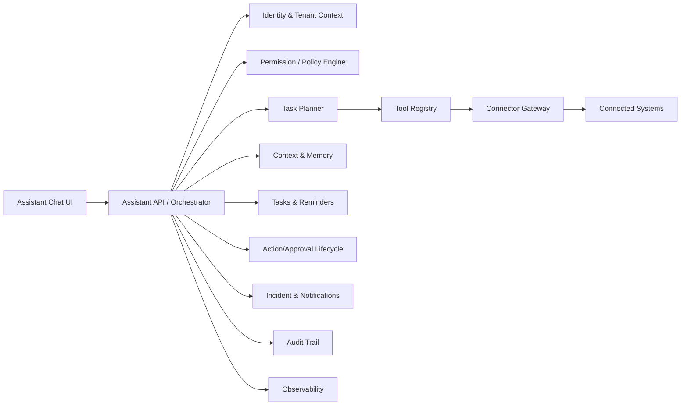

# BigBill AI Assistant — Technical Stack, Engineering Rules & Agent Skills Workbook
## Loop 1 Implementation Companion

**Purpose:** This workbook is the technical companion to `BigBill_AI_Assistant_Loop1.md`. It teaches implementation agents the preferred technical environment, architectural boundaries, programming rules, security expectations, agent skills, workflows, and verification standards.

**Authority rule:** This is a guidance document, not permission to replace the existing repository stack. The actual repository, its agent instructions, package manifests, architecture, deployment and working patterns are the source of truth. If guidance here conflicts with a functioning repository convention, document the conflict and preserve the established convention unless the coordinator explicitly approves a change.

---

# 1. Product definition and engineering posture

Build a **separate, multi-tenant AI assistant product** with an independent chat interface and a clean integration boundary. BigBill Systems is tenant/customer one. Do not hardcode BigBill as a privileged special case.

The product is not a chatbot skin. It is a controlled orchestration layer that can understand requests, retrieve authorized context, plan, draft, request approval, execute permitted tools, verify outcomes, report incidents, and retain user-approved context.

### Engineering priorities, in order

1. Correctness and safety
2. Existing-system reuse and compatibility
3. Tenant isolation and permission enforcement
4. Clear, maintainable modular boundaries
5. Good user experience and accessibility
6. Observability and incident diagnosis
7. Cost and latency control
8. Extensibility for commercial multi-tenant SaaS
9. Visual polish

Do not sacrifice security or working infrastructure for novelty.

---

# 2. Stack guidance — repository-first, not stack invention

The implementation agent MUST inspect the target repository and report its actual stack before writing code. Do not create a new framework, database, auth system, deployment stack, queue, telemetry vendor, or paid service merely because it is listed below.

## 2.1 Known BigBill/Khaps ecosystem technologies (reference only)

These are technologies already used or encountered in the wider BigBill environment; they are not all mandated for this assistant repo.

| Layer | Known ecosystem/reference | Implementation guidance |
|---|---|---|
| Web frontend | Next.js App Router, React, TypeScript | Prefer existing framework and typed patterns |
| API/backend | Node.js, Express; Next route handlers in other projects | Reuse repo's established server/API pattern |
| Mobile | Expo / React Native in Khapy | Not required for Loop 1; future parity |
| Monorepo | pnpm workspaces in Khapy; npm workspaces in MotherTracker | Follow current repo's package manager, never mix |
| Database | PostgreSQL, MySQL/MariaDB in existing products | Reuse existing database; assistant may use Postgres only if repository already supports it or architecture decision approved |
| ORM/schema | Drizzle in Khapy | Follow existing ORM and migration approach |
| Auth | JWT/OAuth in products | Reuse identity/auth contract; no second identity silo |
| Cache/queue | Redis deployed in BigBill ecosystem | Use only if already provisioned and appropriate; no dependency without justification |
| File/object storage | AWS S3/MinIO in ecosystem | Reuse existing storage and access conventions |
| AI providers | OpenAI, DeepSeek, GLM, Qwen, Google, OpenRouter encountered in ecosystem | Provider-neutral adapter; do not hardcode a single model/provider |
| Search | Elasticsearch encountered | Only use if actual needs and existing service warrant it |
| Notifications | Email, WhatsApp, FCM and other provider integrations in ecosystem | Reuse verified connectors; don't duplicate provider clients |
| Deployment | Ubuntu VPS, Coolify, Docker, Traefik in existing infrastructure | Preserve current deployment workflow |
| CI | GitHub Actions, existing repo workflows | Keep established workflow; no paid CI or unrelated changes |
| Styling | Existing design system/CSS primitives | Reuse. No parallel component library unless justified |
| Testing | Repo-specific unit/integration/e2e framework | Inspect scripts; add tests using existing tooling |

**Stack decision rule:** The discovery phase produces an “Actual Stack Inventory” with versions, scripts, service dependencies, deployment patterns, auth, DB, test framework and existing assistant-related code. Only after this inventory is approved may implementation choices be made.

## 2.2 Avoid stack drift

- Do not switch package managers.
- Do not upgrade framework major versions as part of Loop 1.
- Do not add a second ORM or database abstraction.
- Do not add a new auth provider.
- Do not add paid infrastructure, hosted vector databases, paid CI, or AI service subscriptions without explicit approval.
- Do not introduce microservices just to satisfy a diagram.
- Do not change Docker image/build/deployment architecture without a proven need and explicit approval.
- Avoid broad refactors, “cleanup” unrelated to the assistant, and opportunistic dependency upgrades.
- Keep changes small, reversible, and tested.

---

# 3. Recommended modular architecture

Start as a modular application or service with clear boundaries. Split into separate deployed services only when repository and operational evidence justify it.



## Module responsibilities and ownership

| Module | Owns | Must not own |
|---|---|---|
| UI/chat | Conversation UX, previews, approval controls, visible status | Secrets, policy enforcement, connector execution |
| Conversation API | Message lifecycle, conversation access, tenant validation | Direct uncontrolled external actions |
| Orchestrator | Task interpretation, plan, model calls, tool coordination | Bypassing permission policy |
| Model/provider adapter | Provider abstraction, structured output, usage/cost | Business authorization |
| Context/memory | Tenant-scoped retrieval, retention, user controls | Secrets, unapproved cross-tenant data |
| Policy engine | Risk, permissions, approval checks, constraints | UI-only enforcement |
| Tool registry | Tool definitions, schema, risk, scopes, idempotency metadata | Arbitrary dynamically executed code |
| Action service | Proposed actions, previews, approvals, execution state | Invisible actions |
| Connector gateway | Secure provider access, credential use, request/response normalization | Frontend credential exposure |
| Task/reminder module | Assistant-owned tasks only if no existing task system is reusable | Duplicate BOS task/CRM records |
| Incident service | Failure/alert lifecycle, acknowledgement, escalation | Hiding failure or auto-closing critical incident |
| Audit service | Security/action audit events | Full secrets or unnecessary sensitive payloads |
| Integration adapters | Typed contracts with Khapy/BOS/MotherTracker/etc. | Duplicating product logic/data |

---

# 4. Programming language and code quality rules

Apply the repository's existing rules. If the repository uses TypeScript, prefer strict TypeScript and typed boundaries.

## 4.1 Type discipline

- Avoid `any`. If unavoidable at an external boundary, isolate it, validate, and convert immediately.
- Prefer discriminated unions for action states, tool results, permissions and errors.
- Validate runtime input using the existing validation library (e.g. Zod if already installed).
- Never trust TypeScript types for HTTP payloads, connector responses, model outputs, uploaded content or persisted JSON.
- Use explicit return types for public service boundaries and complex functions.
- Avoid unsafe casts (`as unknown as`) and non-null assertions unless justified and locally documented.
- Use exhaustive switch handling where states are finite.
- Treat nullable/optional values explicitly.

## 4.2 Naming and organization

- Use names that describe business intent.
- Follow the repository's naming conventions for components, hooks, files, routes, migrations and tests.
- Keep UI components focused and composable.
- Keep business rules in service/policy modules, not UI components.
- Avoid giant files, “god” services and circular imports.
- Do not duplicate the same validation or policy in several places—centralize reusable rules.
- Do not create generic abstractions for only one use case without a clear reason.

## 4.3 Error handling

- Use typed/structured errors with safe user-facing messages and internal diagnostic details separated.
- No swallowed exceptions or empty `catch` blocks.
- Never report success when an integration call was unverified.
- Preserve draft payload on failure so user work isn't lost.
- Retry only when operation is safe and idempotent; avoid retrying send/publish/spend actions blindly.
- Every external dependency has timeout behavior.
- Distinguish permission denied, expired authorization, validation failure, provider failure, timeout, rate limit, and unknown failure.
- Fail closed for authorization, tenant mismatch, and risk-policy failure.

## 4.4 Code comments and documentation

Comments explain **why** a rule exists, not restate code.
Document security invariants, non-obvious integration behavior, migration decisions and retry/idempotency rules.
Do not leave TODOs without an owner/context. Use issue or loop references where possible.
Update docs/contracts when public APIs or permission scopes change.

## 4.5 Dependency management

- Inspect dependency already present before adding a new package.
- Prefer a dependency already in use and maintained in the repo.
- Explain any new dependency: purpose, size/impact, maintenance, security, alternative already installed.
- Do not add unused dependencies.
- No silent dependency version changes.
- Keep lockfile consistent with package manager.

---

# 5. Repository reconnaissance skill (mandatory first)

Agents must complete this checklist before implementation:

1. Read root README, AGENTS.md and all nested agent instructions in target paths.
2. Inspect git status, current branch, recent relevant commits; don't discard user work.
3. Inspect package manifests, lockfile, runtime version files, scripts and workspace layout.
4. Identify app entrypoints, routing, API boundaries and UI component conventions.
5. Identify authentication, session, roles, tenant context and authorization helpers.
6. Inspect DB schema, migrations, ORM, query patterns, transaction helpers.
7. Identify existing AI/provider abstractions, prompts, tool calling, context retrieval and usage tracking.
8. Identify task/reminder, notification, audit, incident, inbox, email, WhatsApp, calendar, marketing, asset and content workflows.
9. Inspect deployment, environment configuration, Docker/Coolify, proxy, TLS, healthchecks, CI.
10. Run baseline commands using repo scripts—tests, typecheck, lint, build as available.
11. Note known baseline failures separately from failures introduced by work.
12. Create an evidence-linked stack and architecture report.
13. Identify exact proposed files/modules and migration strategy.
14. STOP before implementation until coordinator reviews/consolidates discovery.

No code changes in reconnaissance. If agents cannot access a product repository, state “not available for audit”; do not invent its API.

---

# 6. API design rules

Follow existing route and response conventions. Use versioning if the repo already uses it; don't invent a route scheme inconsistent with existing code.

## 6.1 API boundaries

- Authenticate the caller.
- Resolve tenant and membership from trusted server-side session/token—not client-provided tenant ID alone.
- Authorize access to conversation, connector, action, task, memory and incident for every request.
- Validate input at runtime.
- Limit body sizes and pagination.
- Use predictable error format.
- Avoid returning internal stack traces.
- Include request/correlation IDs for supportability.
- Rate-limit chat, tool execution and connector endpoints as appropriate.
- Protect against CSRF if cookie-authenticated mutation endpoints require it.
- Keep connector secrets server-side.

## 6.2 Suggested API contract (adapt to actual routing)

This is conceptual only. Do not create all routes if existing APIs can be reused.

| Capability | Conceptual endpoint |
|---|---|
| List conversations | `GET /assistant/conversations` |
| Create conversation | `POST /assistant/conversations` |
| Get conversation | `GET /assistant/conversations/:id` |
| Send message | `POST /assistant/conversations/:id/messages` |
| List tools/connections | `GET /assistant/connections` |
| Permission request | `POST /assistant/permissions/request` |
| Grant/revoke permission | Existing secure permission flow or `POST/DELETE /assistant/permissions/:id` |
| List actions | `GET /assistant/actions` |
| Preview action | `GET /assistant/actions/:id/preview` |
| Approve action | `POST /assistant/actions/:id/approve` |
| Reject/cancel action | `POST /assistant/actions/:id/reject` |
| List tasks | `GET /assistant/tasks` |
| Create/update task | `POST/PATCH /assistant/tasks` |
| List incidents | `GET /assistant/incidents` |
| Acknowledge incident | `POST /assistant/incidents/:id/acknowledge` |
| Resolve incident | `POST /assistant/incidents/:id/resolve` |

Do not trust route IDs without ownership checks. Tenant and user scoping must be enforced server-side.

---

# 7. Data and persistence rules

Reuse existing database and ORM conventions.

## 7.1 Tenant ownership

Every tenant-owned record must include tenant/workspace ownership or inherit it through a verified parent relationship. Query filters and authorization must enforce isolation—not merely hide records in UI.

Core conceptual entities:
- Organization / Tenant
- Workspace (only if justified by current architecture)
- Membership / Role (reuse identity system)
- AssistantProfile / Configuration
- Conversation
- Message
- ToolDefinition (code-backed registry; DB configuration only if justified)
- Connector
- ConnectorCredentialReference
- PermissionGrant
- ProposedAction / ActionExecution
- Approval
- Task / Reminder (only if not reusing an existing system)
- Incident / IncidentAcknowledgement
- AuditEvent
- MemoryEntry / ContextRecord
- ModelUsage / CostRecord

## 7.2 Migration rules

- Use the repo's migration system and naming.
- Migrations must be forward-safe, scoped and reviewed.
- Avoid destructive migration in Loop 1.
- Do not silently change existing tables' semantics.
- Provide rollback or compensating strategy when feasible.
- Verify migration on a disposable/test database first.
- Never run production migrations during implementation.
- Back up before any production migration.
- Use constraints/indexes for correctness, not only application validation.
- Avoid storing large blobs in relational tables if existing object storage is appropriate.

## 7.3 Memory model

Memory is not an unbounded transcript dump.

Use categories and provenance:
- User preference
- Organization context
- Project context
- Task/commitment
- Decision
- Short-lived task context

For every memory entry, consider:
- Tenant/user scope
- Category
- Source/provenance
- Created/updated time
- Expiry/retention
- Visibility/editability
- Confidence, if inferred
- Whether user explicitly approved persistence

Never store credentials, access tokens, passwords, secrets, private keys, or sensitive personal information as assistant memory. Do not silently infer and retain sensitive attributes. Provide memory inspection, correction, disable and deletion controls according to policy.

---

# 8. AI/model integration skills

## 8.1 Provider-neutral adapter

Keep model provider logic behind a small interface using the repo's existing AI abstraction if present.

The interface should support, where provider capabilities allow:
- Text generation
- Streaming
- Structured outputs
- Tool/function calling
- Model identifier and provider
- Token/usage reporting
- Timeout and cancellation
- Error normalization
- Cost calculation using current pricing data, if available

Do not bake provider-specific request formats into business logic.

## 8.2 Model routing

Routing is a later configurable capability. In Loop 1:
- Use existing provider selection and credentials if present.
- Do not introduce a new provider merely to test the assistant.
- Keep model choice configurable and observable.
- Avoid hardcoding model names across components.
- Never treat model output as trusted executable instructions.

## 8.3 Prompt and context construction

- Separate system instructions, organization policy, user request, retrieved data and tool outputs.
- Label untrusted retrieved content.
- Minimize data passed to models.
- Use bounded context and summarize older context when needed.
- Never put secrets into prompts.
- Model-generated tool arguments must pass schema validation and authorization.
- Tool output cannot override system policy.
- Retrieved content cannot grant permissions or instruct the assistant to bypass controls.
- Include explicit refusal/stop conditions for unauthorized or unsafe actions.
- Keep prompt versions traceable where practical.
- Record model/provider/latency/usage safely, not sensitive prompt content by default.

## 8.4 Hallucination prevention

- Ground operational claims in retrieved data or approved context.
- Distinguish verified facts, estimates, assumptions and recommendations.
- For reports, show data source and “as of” time.
- When a connector fails, do not substitute remembered or stale data without labeling it.
- Require human approval for external claims, customer-facing content and consequential actions.
- Never invent that an action completed, a file attached, a message sent, or an integration connected.

---

# 9. Tool/skill design rules

Every tool must have a typed, reviewed definition. Tools are not arbitrary shell access or unconstrained code execution.

Required tool metadata:
- Stable tool ID/name
- Description
- Input schema
- Output schema
- Risk class (R0–R4)
- Required permission scopes
- Tenant/user ownership rules
- Idempotency behavior
- Timeout
- Retry policy
- Audit requirements
- Confirmation/approval requirement
- Feature flag and availability status

Tool lifecycle:
1. Model proposes tool and validated arguments.
2. Server validates schema.
3. Server resolves tenant/user.
4. Policy engine checks permission and risk.
5. If needed, action preview is stored.
6. User approves the specific action.
7. Execution occurs with timeout/idempotency.
8. Result is verified.
9. Audit record is created.
10. Assistant reports verified outcome or failure.

**Never let a model-generated plan bypass the tool registry. Never provide general-purpose shell, SQL, filesystem, browser or code-execution tools to the assistant in Loop 1.**

---

# 10. Permission and approval implementation rules

## Permission request UX must state

- Connection/tool name
- Purpose
- Read/write capabilities
- Exact scopes
- Data categories accessed
- Action categories enabled
- Expiry (if supported)
- Grantor
- Revocation control
- Whether permission enables future actions or only the current request

## Enforcement

- Deny by default.
- Check permissions server-side on every tool execution.
- Check user and organization membership.
- Check resource-level authorization.
- Re-check immediately before execution; a grant may have been revoked since preview.
- Bind approvals to a specific action payload/hash or immutable action version.
- Editing an approved action invalidates approval.
- Expired/revoked grants block execution.
- No approval can be inferred from “do whatever,” previous approval or silence for R3/R4.
- External sends, publication, spending, destructive operations and access changes require explicit approval in Loop 1 and remain disabled unless later loop implements them safely.

---

# 11. Frontend engineering and design rules

Follow existing design system and interaction patterns.

## Chat layout
- Clean, responsive, keyboard-accessible chat.
- Conversation history, new-chat action, message timestamps/status.
- Clear assistant vs user message distinction.
- Tool activity should be understandable (“Checking permission”, “Reading approved source”, “Draft prepared”), not a mysterious spinner.
- Stop/cancel when supported.
- Retry failed requests safely.
- Preserve unsent message input after failure.
- Support long messages and readable code/structured content.
- Avoid excessive cards, giant buttons, decorative gradients, artificial “AI” visuals and redundant navigation.
- No fake tool activity or simulated connected status.

## Action preview
Show:
- Action type
- Target system
- Recipient/target, if relevant
- Content/data changes
- Permissions used
- Risk
- Approval requirement
- Outcome/status

## Permission center
- Connection state
- Permissions granted
- Scope explanation
- Granted by/when
- Expiry
- Revoke button
- Reauthorization state
- Recent usage and relevant audit events

## Incident center
- Severity
- Incident title
- Description/impact
- Evidence or correlation ID
- Suggested next step
- Status and acknowledgement
- Avoid alarmist UI for ordinary recoverable failures

## Accessibility
- Semantic controls and labels.
- Keyboard navigation.
- Focus states.
- Sufficient contrast.
- Screen-reader announcements for loading/errors/action status.
- Reduced-motion support where applicable.
- Responsive layout tested at mobile, tablet and desktop widths.

---

# 12. Integration skills: connect, do not duplicate

## Integration inventory is mandatory

For each target system, agents must inspect and record:
- Repo access and current branch
- Auth method
- API routes/contracts
- Permissions
- Existing workflow
- Data model
- Webhooks/events
- Rate limits/constraints, if known
- Credential availability (never expose values)
- Test environment
- Missing capability
- Reuse recommendation

### Initial integration priorities

| System | Loop 1 goal | What not to duplicate |
|---|---|---|
| BigBill BOS | Business context/tasks/leads if verified | CRM, finance, lead records, dashboard |
| Khapy | Creative brief/content workflow audit and first safe integration contract | Content Studio, calendar, media library, distribution |
| MotherTracker | Read-only integration audit | Fleet, trips, drivers, vehicle records |
| Email | Draft output first; connector availability audit | Existing mail service |
| WhatsApp | Draft output first; connector availability audit | Existing messaging infrastructure |
| Calendar | Read-only audit if available | Calendar UI and event storage |
| Web research | Safe research tool contract, if existing provider/browser is available | New crawler stack without approval |

---

# 13. Khapy creative-brief contract (conceptual)

The assistant should pass a structured creative brief rather than free-form unbounded instructions.

```ts
type CreativeBrief = {
  organizationId: string;
  campaignName: string;
  objective: string;
  productOrService: string;
  audience: string;
  keyMessage: string;
  offer?: string;
  channels: Array<"facebook" | "linkedin" | "instagram" | "whatsapp" | "web">;
  tone: string;
  formats: string[];
  brandConstraints: string[];
  requiredClaims: string[];
  prohibitedClaims: string[];
  requestedDeliverables: string[];
  approvalStatus: "draft";
};
```

This is illustrative. Use the actual repo types, validators and Khapy API contract after discovery. Do not copy this type if a canonical contract exists.

Flow:
1. Assistant collects requirements and approved product facts.
2. Brief is validated.
3. User previews the brief.
4. User authorizes transfer to Khapy.
5. Khapy creates content/assets using its own pipeline.
6. Khapy returns content/asset IDs and status.
7. Assistant shows results and links to the source in Khapy.
8. Scheduling/publishing stays under Khapy's own approvals and is disabled for Loop 1.

---

# 14. Incident, monitoring and reliability rules

Every tool or connector operation must produce a meaningful outcome.

## Incident categories
- Permission/authentication
- Connector outage
- Rate limiting
- Timeout
- Validation
- Tenant/security violation
- Model/provider failure
- Storage/database
- Unexpected state
- Action verification failure

## Incident lifecycle
`open → acknowledged → investigating → resolved` (adapt to repo conventions).

## Failure handling
- Fail closed on authorization/security failures.
- Do not retry non-idempotent operations blindly.
- Retry transient safe reads only within bounded limits.
- Preserve user draft/content.
- Record correlation ID.
- Do not log secrets or raw sensitive content.
- Notify user with impact and safe next step.
- A tenant mismatch or possible data leak should block the workflow and escalate as critical.
- Never auto-resolve critical incidents without verified resolution.

## Observability
Reuse current logging/metrics/alerting. Add:
- Correlation/request ID
- Tenant-safe identifiers (pseudonymous or internal IDs)
- Tool ID
- Risk class
- Permission decision
- Approval state
- Duration
- Outcome
- Retry count
- Provider/model ID
- Usage/cost if available

Do not log complete emails, WhatsApp messages, tokens, secrets, sensitive records or prompts by default. Log minimal diagnostic metadata and redact.

---

# 15. Testing workbook

Use the repo's test tools. Add test layers appropriate to the changed module.

## Unit tests
- Permission policy evaluation
- Tool risk classification
- Schema validation
- Action-state transitions
- Approval invalidation after payload edits
- Retry/idempotency policy
- Incident lifecycle
- Context/memory scoping
- Model-output validation

## Integration tests
- Authenticated conversation CRUD
- Tenant membership checks
- DB migrations
- Connector permission checks
- Tool registry execution
- Revocation blocks subsequent action
- Action preview/approval/execution lifecycle
- Incident creation/acknowledgement
- Audit records

## Security tests
- Cross-tenant conversation access denied
- Cross-tenant memory access denied
- Cross-tenant connector access denied
- Cross-tenant task/incident access denied
- Forged tenant ID ignored/rejected
- Revoked permission blocked
- Expired permission blocked
- Tool schema injection rejected
- Retrieved prompt-injection content cannot alter policy
- Secret redaction verified
- Approval cannot be replayed against changed payload
- Unauthorized send/publish/spend/destructive tool blocked

## UI/e2e tests
- Start new chat
- Continue conversation
- Loading/error/retry
- Permission prompt and denial
- Permission grant/revoke
- Action preview
- Approval controls disabled for unavailable action
- Task create/update
- Incident notification and acknowledgement
- Responsive layout and keyboard basics

## Test data
- Use synthetic data.
- Do not use live customer messages or real credentials.
- Seed two separate organizations with separate users, contexts and connectors.
- Test negative cross-tenant cases, not only happy paths.

---

# 16. Agent skills and division of work

Agents should be specialists with clear deliverables and bounded ownership. Do not allow agents to edit the same modules concurrently.

## Skill A — Repository Scout / Stack Archaeologist
**Mode:** Read-only

Expertise:
- Monorepos and codebase mapping
- Framework/version discovery
- Auth/tenant architecture
- DB and migration patterns
- Existing AI and integrations
- Build/deploy/CI analysis

Deliverables:
- Actual stack inventory
- Repository structure map
- Existing component/service reuse matrix
- Baseline commands/results
- Proposed module boundaries
- Risks and unknowns

## Skill B — Assistant Product Architect
Expertise:
- Modular SaaS design
- Multi-tenant architecture
- Assistant orchestration
- Tool contracts
- Action lifecycle
- Integration boundaries

Deliverables:
- Architecture decision record (ADR)
- Module responsibility map
- API/event contracts
- Data ownership decisions
- Loop 1 implementation sequence

## Skill C — UX/Frontend Engineer
Expertise:
- Responsive interfaces
- Existing design-system reuse
- Conversational UI
- Accessible controls
- Action/permission/incident states

Deliverables:
- Chat shell
- Conversation history
- Permission UX
- Action preview
- Task/incident views
- Responsive screenshots and QA notes

## Skill D — Backend/API Engineer
Expertise:
- Typed APIs
- Auth and tenant validation
- Persistence
- Service boundaries
- Transactions
- Error handling

Deliverables:
- Conversation APIs/services
- Tenant-safe persistence
- Tool/action lifecycle APIs
- Task/incident APIs or verified reuse
- Tests and migrations

## Skill E — AI Orchestration Engineer
Expertise:
- Provider abstractions
- Prompt/context assembly
- Structured outputs
- Tool calling
- Model safety
- Usage and cost instrumentation

Deliverables:
- Provider adapter reuse/extension
- Assistant orchestration
- Tool-call validation
- Prompt injection boundaries
- Usage metrics
- Fallback policy

## Skill F — Security/Permission Engineer
Expertise:
- Least privilege
- RBAC
- OAuth/token safety
- Tenant isolation
- Auditability
- Threat modeling

Deliverables:
- Permission matrix
- Threat model
- Policy enforcement
- Grant/revoke flow
- Audit design
- Security tests

## Skill G — Integration Engineer
Expertise:
- Existing product APIs
- Connector authentication
- Event/webhook contracts
- Provider normalization
- Retry/idempotency

Deliverables:
- Integration audit
- Connector contracts
- Khapy creative-brief integration or verified gap
- Reuse matrix
- Integration tests

## Skill H — QA / Independent Reviewer
**Must not rely on implementer self-certification.**

Expertise:
- Test strategy
- Regression
- Tenant isolation
- Permission negative tests
- UI verification
- Reliability

Deliverables:
- Acceptance matrix
- Independent review findings
- Reproduction steps
- Test/build evidence
- Release verdict

## Skill I — DevOps/Release Engineer
Expertise:
- Existing deployment
- Env/secrets
- Containers
- Health checks
- Backups
- CI

Deliverables:
- Local/staging instructions
- Env variable documentation (names only, no values)
- Health/readiness checks
- Migration/rollback plan
- Deployment-risk assessment

---

# 17. Multi-agent orchestration rules

## Discovery first
Phase 0 is read-only. Agents may research independently, but the coordinator must consolidate results before implementation.

## Non-overlapping implementation
After discovery:
- Assign clear module/file ownership.
- Avoid two agents modifying the same files.
- Use integration branches or commits according to existing repo conventions.
- Agree on shared types/contracts before parallel work.
- If a shared contract changes, pause dependent agents and reconsolidate.

## Coordinator responsibilities
- Read the Loop 1 specification and this workbook.
- Read all repository instructions.
- Assign the Scout first.
- Consolidate architecture and baseline evidence.
- Approve bounded tasks.
- Track dependencies and conflicts.
- Ensure implementation agents provide file lists, tests and evidence.
- Run final QA with an independent agent.
- Do not let Loop 2 begin automatically.

## Agent behavior
- Do not assume access to sibling repositories.
- Do not claim a connector/API is real until inspected.
- Do not commit secrets.
- Do not remove or overwrite user changes.
- Do not expand scope to unrelated product improvements.
- Stop and report blockers instead of fabricating workarounds.
- Ask the coordinator only for genuinely blocking decisions; prefer safe repository-consistent choices otherwise.

---

# 18. Working definition of “skills” for the assistant platform

The product may eventually expose capabilities as **Skills**, but Loop 1 should distinguish these three concepts:

### A. Internal agent implementation skills
Specialist roles for OpenCode (Scout, architect, security, frontend, backend, integration, QA).

### B. Assistant tools
Executable capabilities registered in a controlled tool registry (read data, draft content, create task, etc.). A tool has code, schema, permissions and risk metadata.

### C. User-facing workflow skills
Reusable task recipes that combine reasoning and permitted tools, for example:
- Daily briefing
- Meeting preparation
- Sales follow-up
- Prospect research
- Campaign preparation
- Content repurposing
- Draft customer response
- Incident triage
- Project status summary
- Weekly founder review

A “skill” must not be a way to bypass permissions. Skills call registered tools and are subject to the same policy.

---

# 19. Future skill catalog (not all Loop 1)

Build a roadmap catalog; implement only the Loop 1 subset.

| Skill | Input | Expected output | Tool access (future, gated) |
|---|---|---|---|
| Daily Briefing | User/org, date | Priorities, deadlines, blockers | Task/calendar/CRM read |
| Meeting Prep | Attendees, meeting | Agenda, context, questions | Calendar/CRM read |
| Follow-up Manager | Leads/messages/tasks | Follow-up list and drafts | CRM/email/WhatsApp |
| Prospect Research | Target company | Evidence-backed prospect brief | Web research |
| Campaign Planner | Product, audience, objective | Campaign plan | Khapy brief/create |
| Content Studio Companion | Approved brief | Platform-specific content | Khapy creation |
| Email Drafting | Context, intent | Reply/outreach draft | Email read/draft |
| WhatsApp Drafting | Context, recipient | Message draft | WhatsApp read/draft |
| Proposal Assistant | Scope/pricing | Proposal draft | BOS quote read/write draft |
| Project Monitor | Project state | Progress, risks, next steps | Project/task reads |
| Incident Triage | Incident data | Diagnosis and safe plan | Observability reads |
| Research Analyst | Question | Evidence summary with sources | Web research |
| Report Builder | Authorized data | Summary/report draft | Product data reads |
| Content Repurposing | Approved source content | Adapted content variants | Khapy |
| Weekly Review | Metrics/tasks | Review, priorities | Authorized system reads |

---

# 20. Local development and environment rules

- Read `.env.example` and existing configuration.
- Never commit `.env`, credentials, API keys, access tokens, SMTP passwords or private keys.
- Add only environment variable names and safe descriptions to docs.
- Validate required env vars at startup or through existing config validators.
- Do not print secret values during validation.
- Use separate local/test/staging/prod credentials.
- Never point tests at production.
- Never run destructive database commands without explicit confirmation and verified backup.
- Prefer seeded synthetic data.
- Provide documented setup commands consistent with repository scripts.
- Use existing container/dev workflow.
- Preserve service ports and networks unless a justified change is approved.
- Do not create new paid resources.

---

# 21. Git and implementation discipline

- Start with `git status`; never assume a clean tree.
- Record branch and baseline commit.
- Do not discard user work.
- Follow existing branch/PR conventions.
- Make small, logical commits if requested by repo workflow.
- Keep diffs focused on Loop 1.
- Avoid drive-by formatting.
- No forced pushes, rebases that rewrite shared history, branch deletion or deployment unless explicitly authorized.
- Report files changed and why.
- Review diff before finalizing.
- Verify no secrets or generated clutter.

---

# 22. Definition of done for every implementation task

An agent's task is not complete because code was written.

Required:
- [ ] Scope satisfied
- [ ] Existing patterns respected
- [ ] Input validation
- [ ] Authorization/tenant checks
- [ ] Error handling
- [ ] Relevant tests
- [ ] No secret exposure
- [ ] Migration safety (if applicable)
- [ ] Lint/typecheck/build relevant to scope
- [ ] UI verified where applicable
- [ ] Independent review where security-critical
- [ ] Documentation updated
- [ ] Evidence of actual command output
- [ ] Remaining limitations disclosed

---

# 23. Loop 1 implementation sequence (recommended)

1. Repository reconnaissance and baseline.
2. Architecture/contracts review and approval.
3. Auth/tenant integration.
4. Conversation persistence and chat shell.
5. Assistant/provider orchestration.
6. Tool registry (draft/read-safe tools only).
7. Permission center and policy enforcement.
8. Action preview/audit lifecycle.
9. Task/reminder capability or reuse.
10. Incident notification lifecycle.
11. BigBill founder assistant workflows.
12. Khapy connector audit and creative brief handoff (only if API is verified).
13. Independent QA/security review.
14. Staging demonstration.
15. Loop 1 close-out report and Loop 2 proposal.

---

# 24. Acceptance matrix supplement

In addition to Loop 1 acceptance criteria, verify:

- [ ] Actual stack inventory exists and is evidence-based.
- [ ] No package manager or framework change.
- [ ] Modular boundaries documented.
- [ ] Every API has auth, tenant scope, runtime validation and safe errors.
- [ ] Every tool is registered, typed and permission-gated.
- [ ] Every action has risk, idempotency and approval metadata.
- [ ] No general shell/browser/SQL execution exposed to model.
- [ ] Provider adapter does not leak vendor specifics into business logic.
- [ ] Model output is validated before tool execution.
- [ ] Retrieved content is treated as untrusted.
- [ ] Memory has scope, provenance, retention and user controls.
- [ ] No secrets or sensitive payloads in logs.
- [ ] No shadow CRM, task manager, content studio, calendar, fleet system or finance records created unnecessarily.
- [ ] Cross-tenant negative tests pass.
- [ ] Permission revocation is effective.
- [ ] Action approval is bound to the action preview.
- [ ] External actions remain disabled in Loop 1.
- [ ] UI states are real, not mocked in production path.
- [ ] Tests/build/typecheck/lint pass or baseline failures are documented.
- [ ] Independent QA evidence is recorded.

---

# 25. Coordinator prompt to use with the two Loop 1 documents

```text
Read both documents in full:

1. BigBill_AI_Assistant_Loop1.md
2. BigBill_AI_Assistant_Technical_Workbook_Loop1.md

Treat them as one Loop 1 specification set. The implementation workbook
defines engineering discipline, stack guidance, programming rules,
architecture boundaries, security practices, agent skills and verification.

Important:
- Repository stack and existing instructions take precedence over examples
  in the workbook.
- Phase 0 must be read-only reconnaissance.
- No coding before the coordinator consolidates the evidence and architecture.
- Preserve stable infrastructure and deployment patterns.
- No paid services, CI changes, framework upgrades, new provider,
  microservice split or production deployment without explicit approval.
- Use multi-agent execution with clear file/module ownership.
- No duplicate systems: audit and reuse BigBill BOS, Khapy,
  MotherTracker, messaging, task, calendar and content workflows.
- All connectors and tools must be registered and permission-gated.
- Drafting is allowed; sending, publishing, spending, destructive actions
  and access changes are disabled for Loop 1.
- Tenant isolation, audit, approval, incident reporting and independent QA
  are mandatory.
- Agents must report actual evidence, not presumed completion.

Execute the phases and acceptance criteria in Loop 1. Do not start Loop 2.
```

---

## 26. Final instruction to implementation agents

The aim is to create an assistant platform that can become increasingly useful without becoming unsafe, unmaintainable, expensive, or entangled with one BigBill product.

Think in reusable contracts, controlled capabilities, explicit permission, verifiable outcomes and modular integration.

**Build the foundation once. Integrate carefully. Reuse existing business systems. Prove each capability. Do not fake what is not connected.**
